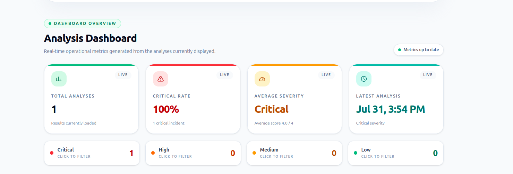
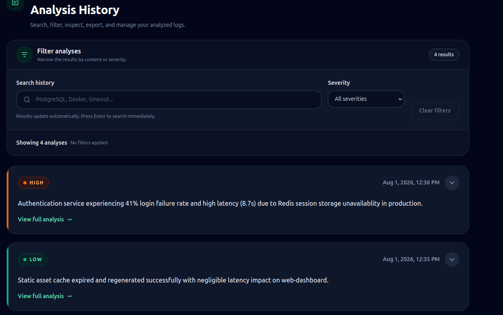

# 🚀 KANYI

> AI Log Intelligence
>
> We find what hides in your logs.


---

## 📖 Overview

KANYI is an AI Log Intelligence platform that uses Google's Gemini AI to uncover severity, root causes, and actionable insights in infrastructure and application logs.

The platform automatically classifies incidents by severity, identifies the most likely root cause, provides actionable recommendations, and stores analysis history for authenticated users.

---

## ✨ Features

- 🔐 JWT Authentication
- 🤖 AI-powered log analysis
- 📊 Interactive dashboard
- 📁 Analysis history
- 🔍 Search and filtering
- 🗑 Delete analyses
- 🐳 Docker & Docker Compose
- 📈 Severity statistics
- ⚡ Fast React + Vite frontend
- 🗄 PostgreSQL persistence
- 🛡 Rate limits and hardened HTTP headers
- 📈 Per-user monthly AI usage quotas
- 🔑 Secure password-recovery API
- 💳 Billing-ready individual account model

---

## 🏗 Architecture

```text
                React + TypeScript
                       │
                       ▼
                Express REST API
                       │
         ┌─────────────┴─────────────┐
         ▼                           ▼
     PostgreSQL                Google Gemini
                       │
                       ▼
                 Docker Compose
```

---

## 🛠 Tech Stack

### Frontend

- React
- TypeScript
- Vite
- Tailwind CSS

### Backend

- Node.js
- Express.js

### Database

- PostgreSQL

### AI

- Google Gemini API

### DevOps

- Docker
- Docker Compose

---

## 📸 Screenshots

Coming soon...

---

## 🚀 Getting Started

### Clone the repository

```bash
git clone https://github.com/yourusername/devops-ai.git
cd devops-ai
```

### Configure environment variables

```bash
cp backend/.env.example backend/.env
```

Fill your credentials.

For password recovery, configure the SMTP variables and `FRONTEND_URL` in
`backend/.env`. In production, set `CORS_ORIGINS` to the exact frontend origin
and `TRUST_PROXY_HOPS` to the number of trusted proxies in front of Express.

### Upgrade an existing database

Docker initialization scripts only run for a new PostgreSQL volume. Apply the
idempotent SaaS migration to an existing database before deploying this version:

```bash
psql "$DATABASE_URL" -f database/migrations/001_saas_foundations.sql
```

New databases receive the same schema from `database/init.sql`.

### Individual account plans

- `free`: 50 AI analyses per calendar month
- `pro`: 500 AI analyses per calendar month when the subscription status is
  `active` or `trialing`

`GET /api/account` returns the authenticated user's safe subscription summary
and current monthly usage. Provider customer/subscription identifiers remain
server-side. Checkout and webhooks are intentionally deferred until a billing
provider is selected.

Password-reset links expire after one hour, are stored only as SHA-256 hashes,
can be used once, and revoke existing sessions when successfully used.

### Run with Docker

```bash
docker compose up -d --build
```

---

## 🌐 Application

| Service | URL |
|----------|-----|
| Frontend | http://localhost:5173 |
| Backend | http://localhost:3000 |
| PostgreSQL | localhost:5433 |

---

## 📂 Project Structure

```text
backend/
frontend/
database/
docker-compose.yml
README.md
```

---

## 🧪 Roadmap

- [x] JWT Authentication
- [x] Gemini AI Integration
- [x] Docker Support
- [x] Dashboard
- [x] Analysis History

### Next Version

- [ ] Deploy to Production
- [ ] CI/CD Pipeline
- [ ] Monitoring
- [ ] Export Reports
- [ ] Role-Based Access Control

---

## 📸 Screenshots

### 🔐 Login


### 📊 Dashboard



### 🤖 AI Analysis


### 📚 History




## 🎥 Demo

A complete walkthrough of the application is available in:

`docs/demo/devops-ai-demo.mp4`


## Source code available upon request for recruitment purposes.###

## 👨‍💻 Author

Francisco Vargas

Backend • Frontend • DevOps • AI

---

## 📄 License

Copyright © 2026 Francisco (Fran) Vargas

All rights reserved.

This software and its source code are the intellectual property of Francisco (Fran) Vargas.

No part of this project may be copied, modified, distributed, sublicensed, or used for commercial purposes without prior written permission from the author.

## Engineering readiness

See [the repository assessment and prioritized roadmap](docs/ENGINEERING_ASSESSMENT.md)
for verified capabilities, gaps and release gates, and [security/data handling](SECURITY.md)
for AI transmission, redaction and TLS behavior. The incident-response product
roadmap is not yet implemented; this remains an analysis application.

## Production Reliability

KANYI includes a growing set of production-readiness controls designed to make
incident analysis safer and more reliable.

Current reliability features include:

* Atomic database-backed quota reservations
* Idempotency protection for analysis requests that reuse the same request key
* Automatic release of failed analysis reservations, with expiry after process failures
* Real PostgreSQL integration testing
* Structured backend logging
* Request and correlation IDs
* Centralized API error handling
* Hardened AI and email provider boundaries
* Best-effort secret redaction before AI transmission and new log storage
* Strict validation of AI-generated analysis responses
* Evidence validation against excerpts in the submitted logs
* Verified TLS for hosted PostgreSQL connections
* Dependency security audits, with zero npm vulnerabilities reported in the last recorded audits

Latest recorded local validation (2026-09-21):

* 78 unit and API tests passing
* 13 PostgreSQL integration tests passing
* Frontend lint passing
* TypeScript validation passing
* Production build passing, with an existing bundle-size warning

Production deployment of the latest reliability changes requires database
[migration 003](database/migrations/003_analysis_reservations.sql) and the rollout
procedure documented in [OPERATIONS.md](OPERATIONS.md). These local results do
not verify live-provider behavior or a production deployment.

For additional technical details, see:

* [OPERATIONS.md](OPERATIONS.md)
* [SECURITY.md](SECURITY.md)
* [Engineering assessment](docs/ENGINEERING_ASSESSMENT.md)
* [CHANGELOG.md](CHANGELOG.md)
* [Backend test instructions](backend/TESTING.md)
* [API error and idempotency semantics](API.md)
